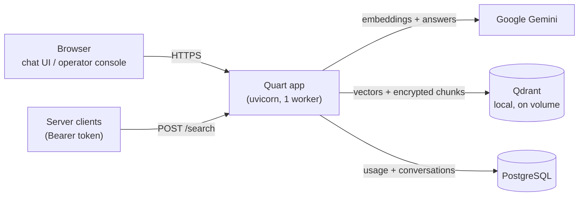

# LLM Assistant (Helios)

Helios is a retrieval-augmented IT-support assistant. Documents are parsed, chunked, embedded and stored in Qdrant. A question retrieves the best matching chunks, and Gemini writes an answer grounded in them. It ships a public chat UI, an operator console for managing documents and reviewing conversations, and a token-protected JSON API.

**Live demo:** https://llm-assistant-production-aa36.up.railway.app/

## Features

- Document ingestion (PDF, DOCX, TXT, Markdown, CSV, Windows `.url` shortcuts) with chunking and Gemini embeddings; unsupported, empty or corrupt files are rejected instead of indexed
- Semantic search over Qdrant with a grounded Gemini answer (Flash-Lite, low reasoning); each model call is time-boxed and falls back to a second model
- Public chat UI with image attachments and per-thread history
- Operator console: status, models, prompt, usage, documents and conversations
- Payload encryption at rest (AES-256-GCM), per-IP/per-session rate limits for browser traffic, and a daily token budget for everyone
- Demo mode that simulates the LLM, so the project runs without any API key

## Architecture



## Tech stack

Python 3.13+, Quart + uvicorn, Qdrant (local mode or remote), Google Gemini (`google-genai`) for answers and embeddings, PostgreSQL via asyncpg (optional), vanilla JS front end with vendored marked, DOMPurify and Chart.js, pytest, ruff, mypy, Docker.

## Quick start

```bash
python -m venv .venv && source .venv/bin/activate
pip install -r requirements-dev.txt
cp .env.example .env        # DEMO=true works without any API key
set -a && source .env && set +a
python -m uvicorn backend.app.main:app --port 8002
```

Open http://localhost:8002/. Without `DATABASE_URL`, usage and conversation history are kept in memory.

## Configuration

All settings are environment variables. [`.env.example`](.env.example) lists every variable with a placeholder and a short description. The most important ones:

| Variable | Purpose |
| --- | --- |
| `DEMO` | `true` simulates the LLM; production uses `false` |
| `GEMINI_API_KEY` | Google AI Studio key, required when `DEMO=false` |
| `EMBEDDING_PROVIDER` / `EMBEDDING_DIM` | `gemini` / `768`; must match the existing collection (demo mode uses deterministic local vectors) |
| `ADMIN_TOKEN` | Operator access; admin routes refuse everything when unset |
| `SEARCH_API_TOKEN` | Bearer token for server-to-server `/search`; also signs chat sessions |
| `PAYLOAD_ENCRYPTION_KEY` | Base64 of 32 random bytes; losing it makes stored text unreadable |
| `QDRANT_PATH` / `QDRANT_URL` | Local Qdrant directory or a remote instance |
| `DATABASE_URL` | Postgres for usage history and conversations |

## API

### `POST /search`

Auth: `Authorization: Bearer <SEARCH_API_TOKEN or ADMIN_TOKEN>`, or the `helios_session` cookie set by `GET /`.

```http
POST /search
Authorization: Bearer <search-token>
Content-Type: application/json

{"query": "How do I reset my VPN password?", "top_k": 5}
```

Optional fields: `images` and `thread_id`. `top_k` is clamped to `MAX_SEARCH_LIMIT`.

```json
{
  "answer": "...",
  "results": [
    {"doc_id": "...", "filename": "vpn-guide.pdf", "chunk_text": "...", "score": 0.82}
  ],
  "used_documents": ["vpn-guide.pdf"],
  "sources": ["vpn-guide.pdf"],
  "demo": false,
  "message": "",
  "embedding_provider": "gemini",
  "thread_id": "...",
  "embed_ms": 120,
  "ai_ms": 900,
  "total_ms": 1050,
  "model": "gemini-3.5-flash-lite"
}
```

### Other routes

| Route | Access |
| --- | --- |
| `GET /`, `GET /backend` | Public |
| `GET /livez` | Public liveness probe, no dependency checks |
| `GET /health` | Public health with dependency status |
| `POST /upload`, `GET /documents`, `GET`/`DELETE /document/<id>`, `/admin/*` | Operator |
| `GET`/`DELETE /backend/api/conversations`, `/backend/api/{system,connections,metrics,prompt}`, `/monitor` | Operator |

## Operator console

`/backend` shows live status, models, prompt and usage. To manage documents and conversations, sign in with the admin token: the console calls `POST /backend/api/session`, which sets an HttpOnly, Secure, SameSite=Strict `helios_operator` cookie valid for 12 hours (`DELETE` signs out, `GET` reports the state). Cookie-authenticated requests also send `X-Requested-With: helios`. Scripts can use `Authorization: Bearer <ADMIN_TOKEN>` instead.

## Security and privacy

- Admin auth fails closed; see [SECURITY.md](SECURITY.md) for the full model and how to report vulnerabilities.
- Chunk text is encrypted at rest; with `DEMO=false` the app refuses to start without a valid `PAYLOAD_ENCRYPTION_KEY`.
- Server clients authenticated with a token are exempt from the per-IP and per-session limits; browser traffic is keyed on `X-Real-IP`, never on the spoofable first `X-Forwarded-For` hop.
- Stored conversations pass through PII redaction; queries and model output are not logged.
- Strict CSP: same-origin only, no inline scripts or styles, all front-end libraries vendored under `backend/static/vendor/`.
- Rate limits and a daily token budget bound abuse and cost.
- Secrets live only in environment variables; never commit `.env`.

## Development

```bash
ruff check .
ruff format --check .
mypy backend/app
pytest --cov=backend/app --cov-report=term
pip-audit -r requirements.txt
```

Run these checks locally before pushing to `main`; Railway deploys every push to `main` automatically.

<!-- project-tree -->
```text
backend/
  app/
    __init__.py        create_app() factory
    main.py            app = create_app()  (uvicorn target)
    api/               chat (/ and /search), documents, admin, health, session, console
    core/              config, logging, security (headers, CSP, auth), service container
    services/          rag, ingest, parser, chunking, embeddings, llm, gemini, prompt, vector_store
    infra/             rate_limit, usage_db, crypto, privacy, demo_lock, model_catalog, monitor, tasks
  templates/           index.html (chat), backend.html (console)
  static/              chat.js, backend.js, common.js, styles, fonts, vendor/
tests/                 pytest suite (213 tests)
```
<!-- /project-tree -->

## Deployment

Production runs on Railway and deploys from `main` using the [`Dockerfile`](Dockerfile).

- Mount a persistent volume at `/app/qdrant_data`; without it the local Qdrant data is lost on redeploy (or set `QDRANT_URL` for a remote Qdrant).
- Run a single replica with `--workers 1` (already set in the Dockerfile): Qdrant local mode allows only one process.
- Set the variables from `.env.example` in the Railway dashboard; they override the Dockerfile defaults.
- The Railway service, volume and build settings are defined as code in [`.railway/railway.py`](.railway/railway.py); variables are managed in Railway, not in the repo.
- The container health check calls `/livez`.

```bash
docker build -t llm-assistant .
docker run --rm -p 8002:8002 -e DEMO=true -e ADMIN_TOKEN=dev -e SEARCH_API_TOKEN=dev llm-assistant
```

## License

MIT, see [LICENSE](LICENSE).
